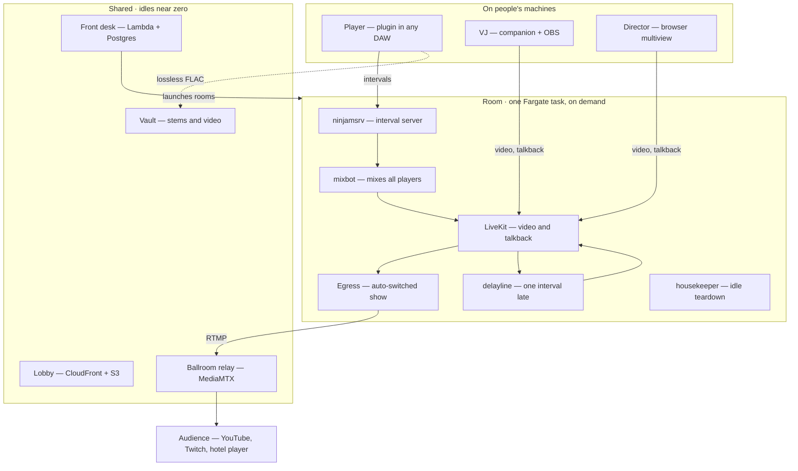
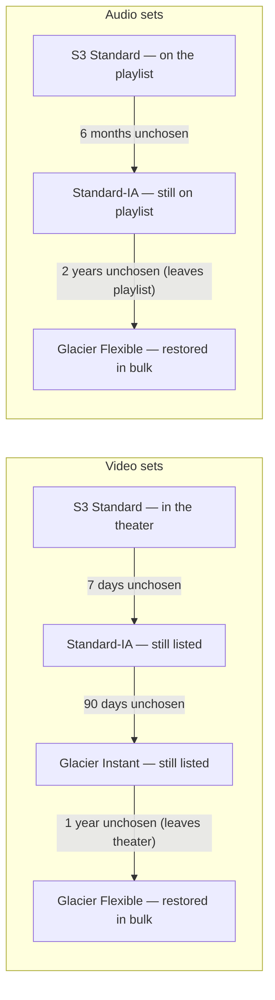
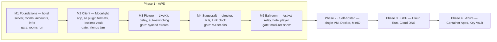

# The Moonlight Hotel — System Design

Exported 2026-10-18 from the living design doc: https://claude.ai/code/artifact/4a429b58-a5d0-4efb-91e1-b2ad985e8792
Diagrams below are Mermaid versions of the doc's drawings.

## Vision & principles

The Moonlight Hotel is an open-source, self-deployable venue where musicians play together over the internet from their own DAWs, VJs and directors shape the picture, and the result streams live to an audience. It runs on moonlighthotel.com as a hosted service, and anyone can deploy the whole suite into their own cloud.

**How this gets built.** There is no MVP, no v1 and no deadline. Every component is built as its final version: no stand-ins, no temporary workarounds, no third-party substitutes for hotel components, and no SaaS. NINJAM is the foundation, and the hotel owns both sides of it: its own client and its own server, built from NINJAM's source. Milestones are the order dependencies force, not release cuts, and nothing is built to be replaced later.

**Principles**

- **Ephemeral by default.** Nothing runs unless a room is in use or a show is scheduled; idle rooms check themselves out.
- **Any DAW.** One plugin (VST3, AU, CLAP, AAX) plus a standalone app; no one changes DAW to join. The hotel's own clients are the only way in; third-party NINJAM clients such as JamTaba and ReaNINJAM are not supported at any milestone, including for testing.
- **Interval sync, not real time.** NINJAM's model: everyone hears everyone one interval late, so distance stops mattering.
- **Lossless where it counts.** Lossy audio for monitoring; full-quality audio for archives and, optionally, the broadcast.
- **Open, portable, no licence gates.** AGPLv3 throughout, self-hostable components only, AWS first and other clouds later.
- **Light to run.** Serverless control plane; containers only for the live media path.

**Non-goals:** sample-accurate real-time jamming, an in-browser DAW, more than 5 players per room (a design limit).

**Glossary**

| Hotel term | System meaning |
| --- | --- |
| Lobby | The web portal at moonlighthotel.com |
| Front desk | Invites, accounts, room keys (credentials) |
| Room | One jam session: ≤ 5 players, its own server task and media room |
| Host | The session parent: owns tempo, BPI, invites, roles, stream settings |
| Guest | A player in a room |
| Green room | A room warming up before a scheduled set, private to that act |
| Ballroom | A festival stage: a schedule of rooms feeding one public output |
| Housekeeping | Idle detection and teardown |
| Vault | Archived stems and recordings in object storage |
| Night porter | Nightly job that moves media between storage tiers |
| Lounge | Unattended between-set output: library music + past VJ sets or generated visuals |

## Roles & user journeys

Five roles cover everyone; a person can hold more than one (a host usually also plays).

| Role | Joins with | Can do |
| --- | --- | --- |
| Host | Portal + plugin | Create room, set BPM/BPI, lock allowed tempo ratios, invite, assign roles, set stream destinations and archive policy, end room |
| Player | Plugin + browser tab | Play, share DAW screen, talkback, archive own lossless audio |
| Director | Browser | See all feeds at higher quality than the broadcast, override auto-switching, pick layouts and overlays, cut to VJ |
| VJ | Companion app + OBS | Receive mix and clock, send a live video source into the room |
| Audience | Browser or YouTube/Twitch | Watch and listen; no login for public shows |

**Invite flow**

1. Host signs in and creates a room with tempo, BPI, roles and invitee emails.
2. The front desk emails each invitee a link with a single-use code.
3. The invitee opens the link, picks a username, and gets a room key: NINJAM credentials, a media token and a plugin config string.
4. Pasting the config string into the plugin connects it; the browser tab joins video and talkback.
5. Keys expire when the room checks out.

**Accounts.** Every person has a persistent account from first contact: email magic link plus passkeys, a profile and credits page, saved stream keys, and ticket history. An invite attaches to an account; a first-time invitee's account is created when they redeem.

**Artist profiles.** Nobody joins a room, takes a VJ or director role, or enters a library without a complete artist profile. It is the attribution on every credit, overlay, stream description and library entry, and the first thing a copyright dispute needs. Nothing private is collected: no legal name, date of birth or address.

| Field | Required | Public | Notes |
| --- | --- | --- | --- |
| Artist name | Yes | Yes | What credits and overlays say |
| Handle | Yes | Yes | Unique and URL-safe; profile page at moonlighthotel.com/@handle; the NINJAM username derives from it |
| What they do | Yes, at least one | Yes | Player, VJ, director (describes the artist; room permissions are separate) |
| Rights confirmation | Yes, per room | No | "What I perform here is mine or cleared", recorded with each room key |
| Profile image | No | Yes | Resized, metadata (including GPS) stripped, subject to the content policy |
| Bio | No | Yes | Plain text, length-capped |
| Links | No | Yes | Website, Bandcamp, SoundCloud, Spotify, YouTube, Instagram and others |
| Location | No | Yes | Free text at whatever detail they choose |
| PRO and IPI number | No | No | Performing rights organization details, used only to answer a rights claim |

- **Frozen credits:** when a room checks out, each set records the artist name every person performed under, so a later rename never rewrites history. The profile page links all of them.
- **Stream descriptions** on YouTube and Twitch list every performer's artist name and links, which is what platforms look for in a dispute.

## System overview

The hotel has three layers: software on people's machines, one short-lived container task per room, and shared services that cost almost nothing when idle.



Players also upload lossless FLAC straight to the vault, and VJ and director feeds pass through LiveKit like everyone else's.

## Client side

Two native pieces run on each person's machine: the **Moonlight plugin** for players and the **Moonlight companion** for VJs and anyone bridging video.

**Moonlight plugin** (C++, JUCE at the version MoonVerb pins, currently 9.0.3, AGPLv3)

- Formats: VST3, AU, AAX and standalone from JUCE; CLAP via clap-juce-extensions.
- Engine: NINJAM client code (njclient) vendored, and evolved together with the hotel's own fork of `ninjamsrv`.
- Monitoring path: Ogg Vorbis intervals to and from the room, as NINJAM does today.
- Lossless path: each local channel's interval is also written as FLAC, named `<room>/<user>/<channel>/<interval>.flac`, and uploaded in the background through presigned URLs. Uploads queue to disk and resume, so a dropped connection never costs audio.
- Host sync: reads the DAW's transport and tempo; warns when the DAW tempo isn't an allowed ratio of the room tempo (see Tempo & clock).
- Room key: one pasted config string (server, port, credentials, media token, upload endpoint).
- Local session save: every participant's stems recorded locally, as ReaNINJAM does, for remixing without the cloud.

**Moonlight companion** (standalone app)

- Clock out: room BPM, beat and interval position over OSC and MIDI clock, plus Ableton Link on the LAN.
- Audio out: the room mix to a virtual audio device for VJ software.
- Video bridges: Syphon (macOS), Spout (Windows) and NDI, building on the existing Syphon work in the moon technologies repo (local, drphilibuster).
- Video in/out of the room: publishes a local source over WHIP; optionally pulls room feeds as Syphon/Spout/NDI textures.
- OBS profile: a ready-made scene collection for VJs who prefer OBS's WHIP output.

## Room data plane

Each room is one Fargate task with a public IP and a per-room DNS name (`<room>.rooms.moonlighthotel.com`); it starts when the host opens the room and stops when housekeeping says it's idle.

| Container | What it does | Notes |
| --- | --- | --- |
| `ninjamsrv` | Interval server for up to 5 players | The hotel's own server, built from NINJAM's server source: room keys as its user list, tempo set only by the housekeeper, interval-boundary events for delayline and the archive |
| `mixbot` | Headless NINJAM client; mixes all players and publishes the mix as an audio track | New code: njclient + a LiveKit SDK |
| `livekit` | WebRTC media: screen shares, talkback, VJ and director feeds | Self-hosted, Apache 2.0; built-in TURN on 443 for strict networks |
| `delayline` | Re-publishes each player's screen one interval late | Buffers encoded packets, never decoded frames, so memory stays small |
| `egress` | Renders the show layout and pushes RTMP and HLS | LiveKit Egress with a custom web template, active only while streaming |
| `redis` | Coordination between LiveKit and Egress | Sidecar, in-memory only |
| `housekeeper` | Reports heartbeats; stops the task after N idle minutes | Also flushes final archive manifests |

**Keeping picture and sound together.** The mix carries what each player played one interval earlier. `delayline` holds every screen track for exactly one interval (length = 60 / BPM × BPI seconds) before re-publishing, so the broadcast shows each player's hands on the bar you're hearing. Directors and the egress layout subscribe to the delayed tracks; players see live ones.

**Auto-switching.** The egress template reads per-player levels from `mixbot` each interval and picks a layout: featured player when one dominates, grid when several are busy, picture-in-picture over the VJ feed when one is present. Cuts land only on interval boundaries. A director's command overrides the automation until they hand control back.

**Director feeds.** Players and VJs publish simulcast layers (1080p, 720p, 360p). Directors subscribe to the top layer; the broadcast layout uses 720p. `delayline` buffers every layer, which at about 4 Mbps for one interval is a few megabytes per feed.

**Talkback.** Mic tracks in the LiveKit room, separate from the music. Private by default; the host can mix it into the stream, ducked under the music. Headphones are required to keep the jam out of the mics.

**Lossless broadcast (optional).** `mixbot` can build the stream mix from the FLAC chunks in object storage instead of the Ogg previews. This adds one more interval of delay to the broadcast (two in total), and `delayline` shifts to match.

**TLS.** A wildcard certificate for `*.rooms.moonlighthotel.com` from Let's Encrypt via DNS-01, stored in Secrets Manager and renewed on a schedule, so rooms start without waiting on certificate issuance.

## Control plane & festival mode

The control plane is one containerized HTTP service (the **front desk**) plus a static web app (the **lobby**); it costs close to nothing when no one is checked in.

**AWS shape**

- Lobby: static app on S3 + CloudFront at `moonlighthotel.com`.
- Front desk: container image run on Lambda through the Lambda Web Adapter, behind API Gateway. The same image runs unchanged on Cloud Run, Azure Container Apps or Docker.
- Data: Postgres on Aurora Serverless v2 with scale-to-zero (rooms, invites, keys, schedules, archive manifests, access events).
- Room launcher: Step Functions runs `ecs:RunTask`, waits for the task's public IP, writes the Route 53 record, then marks the room open.
- Email: SES for invites; plain SMTP elsewhere.
- Secrets: stream keys and the wildcard certificate in Secrets Manager.
- Live room state (who's connected, levels, director commands): a WebSocket channel from the room's `housekeeper` and LiveKit data messages, not the database.

**Festival mode (the ballroom)**

A ballroom is a schedule of sets, each set a room, all feeding one continuous public output.

1. The host builds a line-up: acts, slot times, players, stream destinations.
2. EventBridge Scheduler opens each act's room 15 minutes before its slot as a green room: private, talkback on, no egress.
3. A long-lived **ballroom relay** task (MediaMTX, MIT-licensed) receives RTMP from whichever room is live and forwards one continuous stream to YouTube, Twitch and the hotel's own player. Between sets it switches to the lounge (see Intermissions), so destinations never see the stream drop.
4. At slot time the relay switches inputs; the outgoing room keeps playing until its set ends, then checks out.
5. Cross-act jams are just a room whose guest list spans acts.

**Audience delivery**

- Free: push to YouTube and Twitch; the platforms carry the viewers.
- Hotel player: HLS segments written to S3 and served through CloudFront, with signed cookies for ticketed shows. This is where paid tiers (tickets through Stripe Checkout), audience chat and the lossless audio option live.

**Audience chat.** The hotel player has its own chat over WebSockets from the front desk, with moderators, slow mode, word filters and bans tied to the hotel-wide ban list.

## Intermissions, Muzak & replays

Between sets a **lounge** task keeps the output alive with no director or VJ, playing music from the Muzak library under either past VJ sets or generated visuals; the same recordings feed a replay library on the site.

**The lounge**

- Runs the egress layout with a playlist instead of a room: no players, no LiveKit room.
- Music, in priority order: tracks the next act uploaded for their changeover, then library jams close to the next set's tempo, then the whole library.
- Picture, in priority order: a past VJ set from the replay library (opted in, and long enough for the gap), then generated visuals with butterchurn (MIT, a WebGL port of Milkdrop, https://github.com/jberg/butterchurn) running inside the egress browser. projectM (LGPL-2.1) is the native fallback if software WebGL is too slow on CPU-only Fargate.
- Overlays: now playing with credits, and a countdown to the next act from the ballroom schedule.

**Opt-in at checkout.** When a room ends, the host is asked whether to add the jam to the Muzak library and the show to the replay library. Every player and VJ in that room confirms too, since each owns their part; one decline keeps that part out (a VJ can decline the video while the music still goes in). Contributors grant the hotel a non-exclusive licence to play their work in lounges, on the radio and in replays, and can withdraw it at any time.

**Pipeline**

1. Mixdown from the lossless stems in the vault, using the room's final gain settings, normalized to −14 LUFS.
2. Fingerprint check with Chromaprint against AcoustID. It catches whole copied recordings, not short samples, so the terms still carry most of the weight.
3. The host trims the start and end in the lobby and names the track.
4. Published to the library with credits linking to each contributor.

**Video recording**

| Recording | Source | Kept when |
| --- | --- | --- |
| Program (the show as aired) | Egress, 1080p | Always while streaming; then by retention rules |
| Clean VJ set | Track egress of the VJ's feed, aligned to the delayed mix | VJ opts in |
| Per-player screens | Track egress of each delayed screen | Player opts in, for editors |

**On the site**

- **Hotel radio:** the Muzak library streamed continuously or on demand.
- **Theater / replays:** past shows and VJ sets on demand, as HLS from CloudFront, free or ticketed per show.
- **Credits:** every track, set and show links to its contributors' pages once persistent accounts exist.

## Tempo & clock

The host sets two numbers, BPM and BPI (beats per interval), and they fix the interval length that every player, the mix, the video delay and the archive share.

```latex
T_{interval} = \frac{60 \cdot BPI}{BPM}
```

**Child ratios.** A player may run their DAW at the room tempo times a ratio p/q, as long as BPI × p/q is a whole number of their beats. At 120 BPM with BPI 16 (an 8-second interval), half time (60 BPM, 8 beats), double time (240 BPM, 32 beats) and 3/2 (180 BPM, 24 beats) all line up; 3/4 works only because 16 × 3/4 = 12. The plugin lists the valid ratios for the current room and flags a DAW tempo that matches none. The host can narrow that list for a room (say, 1 and 2 only), and the plugin then offers nothing else.

**Locking the DAW.** Plugins can't set a host's tempo, so the plugin shows the target and its drift. The stronger path is Ableton Link: the plugin (or companion) publishes a local Link session at the player's chosen ratio, with its quantum equal to their beats per interval and its phase pinned to the local interval start. Link-capable DAWs then follow without any manual setting. Link's GPLv2-or-later licence combines with AGPLv3.

**Tempo changes.** The host changes BPM or BPI from the lobby, never from a client; the housekeeper applies it to the server as a privileged system user, and it takes effect at the next interval boundary for everyone. `delayline` and the archive read the new interval length from the same event.

**VJ clock.** The companion sends BPM, beat, bar and interval position over OSC and MIDI clock, offset so beats land on the delayed audio the VJ actually hears.

## Storage & archival

The vault is one bucket where every file's key carries its room, owner and interval number, so stems line up by sorting alone. Archiving is opt-in per room and per player; local recording works with the vault switched off.

```
vault/
  rooms/<room-id>/
    manifest.json              # tempo map, players, channels, interval count
    stems/<user>/<channel>/<interval>.flac
    video/<user>/<track>.mp4   # optional per-person recordings for editors
    show/program.mp4           # the broadcast as aired
    show/hls/                  # segments for the hotel player
  library/
    muzak/<track-id>/          # FLAC master, Opus rendition, credits
    replays/<show-id>/         # MP4 masters (program, clean VJ set), HLS renditions
```

- **Uploads:** presigned PUTs issued by the front desk, scoped to that room and user, valid for the room's life.
- **Manifest:** the `housekeeper` appends tempo changes and interval timestamps, so a stem export can be rebuilt even when BPM changed mid-session.
- **Export:** a stems-download page zips or concatenates intervals per channel on request; nothing is pre-rendered.
- **Lifecycle:** driven by how recently people chose each item, not by age (see Media retention).
- **Portability:** only the S3 API is used, so MinIO, Cloudflare R2 and S3-compatible gateways all work.

**Libraries:** opted-in work moves out of the room's folder into `library/muzak/<track-id>/` and `library/replays/<show-id>/`, outside the rooms' lifecycle rules. A withdrawal deletes both copies.

## Media retention

Media moves down the storage tiers by how long it has gone without someone choosing it. S3 lifecycle rules only count age, and S3 Intelligent-Tiering counts every read, autoplay included, so a nightly **night porter** job moves objects using the hotel's own access records.

**Masters and renditions**

- **Master:** the original (program and VJ set as MP4, mixdown and stems as FLAC). Irreplaceable; this is what tiers down.
- **Rendition:** what players stream (an HLS ladder for video, Opus for audio). Kept in S3 Standard while the item is listed, deleted when it leaves the page, rebuilt from the master if it returns.
- Autoplay, the radio and the lounge read only renditions through CloudFront, so they never touch a cold tier or pay retrieval fees.



A chosen visit while listed copies the master back to Standard and resets its clock. Stems follow their set's audio clock; material from rooms nobody published follows the same clock from the room's end.

The infrequent-access step uses Standard-IA rather than One Zone-IA for masters: One Zone-IA keeps a single copy in one Availability Zone, which suits files we can rebuild, not originals. Moving early from a tier pays its minimum (30 days for IA, 90 for Glacier tiers), so a set that gets popular again is copied back to Standard and the gap is a few cents. Note: the night porter changes storage class with CopyObject in place, so it is not bound by lifecycle rules' 30-day-in-Standard minimum.

**What counts as a visit**

| Counted | Not counted |
| --- | --- |
| Pressing play on a set in the theater or on its page | Lobby and lounge autoplay |
| Choosing a track in the site player | Radio auto-advance |
| Downloading a set or stems | The lounge task reading music |
| Opening a shared link and playing | Crawlers and unverified sessions |

Every stream starts with a signed URL from the front desk that names its purpose: chosen or ambient. A chosen start writes one access event per listener, per item, per day; ambient URLs are never logged as visits. The night porter reads each item's last chosen visit and moves anything past its threshold.

**The site player**

- A player bar on every page except rooms and lobbies; it survives navigation, and listeners pick tracks, skip, or let the radio run.
- Lobbies play the ballroom output itself, in sync for everyone in the lobby. Each person can mute; nobody can skip; chat sits beside it.

**The archive**

- Metadata, credits, artwork and thumbnails never tier down, so the archive is a browsable catalogue of everything the hotel has shown.
- Archived items come back in bulk, by month or year. A request (approved by an admin, or triggered by enough requests) runs an S3 Batch Operations restore at the Bulk retrieval tier, the cheapest option at 5–12 hours, copies the masters back to Standard, rebuilds renditions, and relists the items with fresh idle clocks.
- Batch Operations copies objects up to 5 GB; larger masters go through a small function doing a multipart copy.

**Rough sizes.** A one-hour show is about 9 GB: program 2.7 GB, VJ set 2.7 GB, stems 3 GB, mixdown 0.6 GB. That is roughly $0.21 a month in Standard, $0.11 in Standard-IA and $0.03 in Glacier Flexible Retrieval (approximate, us-east-1 list prices). Video is 60% of each show, which is why it tiers down fastest.

## Portability & infrastructure

Every cloud-specific call sits behind one of seven small interfaces in the front desk, and Terraform mirrors that split, so adding a cloud means writing adapters and a module, not changing the system.

| Interface | AWS (phase 1) | Self-hosted (later) | GCP / Azure (later) |
| --- | --- | --- | --- |
| Object store | S3 | MinIO | S3-compatible gateways or native SDKs |
| Room launcher | ECS Fargate RunTask + Step Functions | Docker / Nomad | Cloud Run jobs / Container Instances |
| Scheduler | EventBridge Scheduler | cron in the front desk | Cloud Scheduler / Logic Apps |
| Email | SES | SMTP | SMTP relay |
| DNS | Route 53 | Static IP or provider API | Cloud DNS / Azure DNS |
| Secrets | Secrets Manager | Files or Vault | Secret Manager / Key Vault |
| Edge blocklist | AWS WAF IP sets on CloudFront (about $6–8 a month) | Caddy deny rules | Cloud Armor / Front Door WAF |

Postgres is the one database everywhere. (Open comment in the doc: keep Postgres, or DynamoDB behind an adapter?)

**Repository layout** (new repo, `drphilibuster/moonlight-hotel`)

```
plugin/        JUCE plugin + vendored NINJAM client
companion/     clock, Syphon/Spout/NDI bridges, WHIP
room/          mixbot, delayline, housekeeper, egress template, task definition
frontdesk/     control-plane service + adapters (incl. night porter)
lobby/         web app: portal, director view, theater, radio, hotel player
infra/
  modules/core/        shared variables and outputs
  modules/aws/         phase 1
  modules/selfhosted/  docker compose + terraform for a single VM
docs/
```

**Phases beyond AWS:** self-hosted single-VM deployment, then GCP, then Azure. Self-hosted goes first because it's the cheapest way for others to try the suite and it proves the adapters.

## Licensing & business model

The whole suite ships under AGPLv3: anyone can run it, and anyone who runs a modified version as a public service must publish their changes.

| Dependency | Licence | Fit with AGPLv3 |
| --- | --- | --- |
| NINJAM client and server (https://www.cockos.com/ninjam/) | GPL; the Wahjam fork states v2 or later | Fine if upstream is v2-or-later; **verify file headers first** |
| JUCE 8 | AGPLv3 or commercial | Same licence |
| VST 3 SDK | MIT since 3.8 | Fine |
| clap-juce-extensions | MIT | Fine |
| Ableton Link | GPLv2 or later, or commercial | Fine |
| LiveKit server and Egress | Apache 2.0 | Fine |
| MediaMTX | MIT | Fine |
| butterchurn | MIT | Fine |
| projectM | LGPL-2.1 | Fine |
| Chromaprint | LGPL-2.1 | Fine |

**Contributions:** a CLA from the first outside pull request keeps the option to dual-license later.

**Hosted vs self-hosted:** moonlighthotel.com charges for convenience and scale (managed rooms, the ballroom, the hotel player, archive storage). The code is the same; nothing in the self-hosted build is crippled or gated.

**Entity.** Moon Technologies LLC holds the copyright, is the party contributors sign the CLA with, and operates moonlighthotel.com. It also owns the AWS account, the Stripe account and the YouTube and Twitch channels, so the business and its liabilities stay separate from personal accounts. Stripe's business verification needs the LLC's EIN, so paid tiers wait on it; everything before the Ballroom milestone runs without it.

**Audio rights:** Cockos' public servers apply a Creative Commons licence to recorded jams. The hotel sets no licence on music; each room's host chooses one, recorded in its manifest.

## Community & content policy

Everyone accepts the hotel's terms, issued by Moon Technologies LLC, before they get a room key, a chat handle or a library credit; the terms protect the people in the rooms and the channels that carry the shows. A lawyer should review them before the first public show, and self-hosted operators get them as a template to adapt.

**Terms (summary)**

- **Original material only** on any broadcast or library room: no uncleared samples, loops or covers. Performers confirm they hold the rights to what they play.
- **No sexual or pornographic content, shock or gore, or hateful or bigoted material**, from anyone, in audio, video, chat, names or artwork. VJs and directors are held to this as much as players.
- **Adult-audience channels by default:** YouTube age restriction on and "made for kids" off; Twitch content classification labels set for mature language and themes. This prevents surprise flags from mature lyrics or visuals; it does not loosen the rule above.
- **Right to ban:** the owner and admins may suspend or ban anyone, at any time, for conduct they judge to undermine people's dignity or rights, or that puts the hotel's stream outlets at risk.

**Enforcement tools**

- **Cut to lounge:** host, director or admin swaps the broadcast for the lounge in one click.
- **Moderator preview:** moderators can watch the live, undelayed feeds. The broadcast runs one interval behind them, which gives a few seconds to cut before something airs.
- **Guest controls:** mute or remove a guest's audio, video or chat.
- **Ban list:** layered, and enforced everywhere a person can enter (see Bans below).
- **Destination kill switch:** stop pushing to one platform without ending the room.
- **Reports and audit:** a report button on the hotel player, and a log of every moderation action.

**Bans**

A ban is applied in layers, so a new email or a new account isn't enough to get back in. Every layer is checked at sign-in, invite redemption, room key issue, the hotel server's connect handshake, LiveKit token issue and chat.

| Layer | Matches on | Notes |
| --- | --- | --- |
| Account | User id | All sessions, keys and tokens revoked at once |
| Email | Normalized address (case, plus-tags, Gmail dots) | Disposable-email domains refused at sign-up |
| Passkeys | Credential IDs registered to the account | Can't be registered to a new account |
| Device | An install ID the Moonlight app generates and keeps in the OS keychain | Checked by the hotel server during the connect handshake, which owning both client and server makes possible |
| IP | Addresses and prefixes (IPv6 /64) seen on the account's sessions and connections | Enforced at the edge (AWS WAF IP set on CloudFront) and by the hotel server; 90 days by default, renewable, because addresses get reassigned |
| Payment | Stripe card fingerprint | Checked at ticket checkout |

- **Evasion:** a new account that matches the account, email, passkey, device or payment layer is refused outright. A match on IP alone goes to an admin review queue instead, because shared networks, carrier-grade NAT and VPNs would otherwise lock out bystanders.
- **Records:** sign-in IPs and device IDs are kept 90 days for every account and for the length of a ban on banned ones, as the privacy policy states.
- **No browser fingerprinting:** it is unreliable and a privacy liability; the device layer comes from our own app instead.

## Cost model

A jam room costs well under a dollar an hour; the only large number is serving a big audience from the hotel's own player. Figures are approximate, at us-east-1 list prices, to be checked against the pricing pages before launch.

| Item | Size | Approx. cost |
| --- | --- | --- |
| Idle hotel (no rooms) | Lambda, CloudFront, Aurora paused, Route 53 | A few dollars a month |
| Jam room, not streaming | Fargate 1 vCPU / 2 GB + media data out | ~$0.10–0.50 per hour |
| Jam room, streaming | Add egress at 4 vCPU / 8 GB | ~$0.30–0.80 per hour + destination traffic |
| Ballroom relay | Small Fargate task for the show's length | ~$0.05 per hour |
| Audience on YouTube/Twitch | Platform-hosted | $0 |
| Audience on the hotel player | 3,000 viewers at 2.5–4 Mbps | ~$300–460 per hour on CloudFront |

The last row is why the free tier pushes to platforms and the hotel player is the paid tier: ticket revenue has to cover roughly $0.10–0.15 per viewer-hour.

## Risks, open questions & roadmap

The three riskiest pieces are all new code on the live path (`mixbot`, `delayline` and the plugin's lossless uploader), so each gets a standalone spike before anything depends on it.

| Risk | Why it matters | Mitigation |
| --- | --- | --- |
| NINJAM licence is GPLv2-only somewhere | Can't combine with AGPLv3 JUCE | Audit headers first; fall back to a clean-room client if needed |
| Picture drifts from sound | The show looks wrong | `delayline` keyed to interval boundaries from `ninjamsrv`, not wall-clock; test with a clap track on camera |
| WebRTC on Fargate behind strict networks | Players or VJs can't connect | Public IP per task, LiveKit TURN on 443, wildcard TLS |
| Player machine load | Plugin + FLAC + screen share + DAW | FLAC writes off the audio thread; screen share at 720p/15 fps by default |
| Aurora cold resume | First request after idle is slow | Lobby shows "waking the hotel"; keep warm during scheduled shows |
| AAX distribution | Pro Tools needs Avid's signing for release builds | In scope: the Avid developer agreement and signing are planned work, after confirming the AAX SDK's terms allow an AGPL plugin |

**Open questions**

- Legal review of the terms, the privacy policy (sign-in IPs and device IDs kept for ban enforcement), and the contributor licence for the libraries, before the first public show.
- Stripe account for Moon Technologies LLC (waiting on the EIN) and ticket pricing for paid shows and replays.
- Video idle thresholds after the first week (90 days to Glacier Instant Retrieval and 1 year to the archive are placeholders).
- Standard-IA vs One Zone-IA for the infrequent-access step (design currently uses Standard-IA for masters).
- Postgres vs DynamoDB-behind-an-adapter (design currently uses Postgres).

**Roadmap**



Milestones are build order set by dependencies, not releases: each produces finished parts of the final system. The NINJAM licence audit comes first because every client and server component depends on it. The terms and moderation tools ship with Picture, before anything airs publicly; the lounge, libraries, replays and media retention ship with Ballroom.
